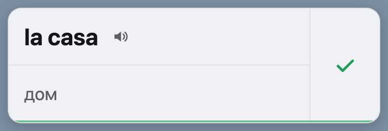

# Cards

Pop-up flashcards that teach you words while you work. A small card appears in the screen corner: the word first, then its translation a few seconds later. Tick it once you know it, and the next most frequent word takes its place.



## Download

Get the latest build from [Releases](https://github.com/matacoder/vocapeek/releases/latest): macOS (Apple Silicon, Intel) and Windows x64. Install steps are in the release notes. Builds aren't signed yet, so macOS and Windows warn on first launch. After that, the app updates itself.

## Supported languages

Any of these can be the language you study or the language of translation, in any direction:

| Language | Dictionary | Frequency source |
|---|---|---|
| Spanish | 3000 words | Film and TV subtitles (OpenSubtitles) |
| English | 3000 words | Film and TV subtitles (OpenSubtitles) |
| Russian | 3000 words | Russian National Corpus, 1950–2007 |

That gives six study directions: es→en, es→ru, en→es, en→ru, ru→es, ru→en. Pronunciation uses your system's voices, so it depends on which voices are installed.

The app's own interface is in Russian only for now.

Each dictionary has three levels, ordered by word frequency:

| Level | Words | Target text coverage |
|---|---|---|
| 1 | 850 | ~50% |
| 2 | 1500 | ~75% |
| 3 | 3000 | ~90% |

The coverage figures are targets and haven't been measured against these lists.

Known limits: translations come from an LLM and haven't been fully proofread. The subtitle-based Spanish and English lists include common profanity. The Russian corpus skews literary and dated, so words like "советский" rank higher than they would today.

Plan and decisions: [features/plan.md](features/plan.md).

## Status

- Desktop (Tauri, macOS and Windows): MVP. Linux builds aren't published yet.
- Web (cards.mtkv.ru), sync backend, mobile widgets: planned.

## Run

Needs Node.js and Rust.

```bash
npm install
npm start        # tray app; first launch opens language setup
npm test         # deck and release manifest tests
cargo test --manifest-path src-tauri/Cargo.toml   # card position, state file
npm run build    # installers in src-tauri/target/release/bundle
```

Smoke test of a built app: `CARDS_SMOKE=<dir> <app binary>` shows two cards using `<dir>` as its data folder (add `CARDS_SMOKE_REAL_PROFILE=1` to use the real profile instead, which also runs the Electron migration), writes `smoke-state.json` to `<dir>`, and exits; `scripts/check_smoke.js` asserts the result. It puts real windows on screen, so CI runs it.

## How it works

- Card: word + "listen" button (system speech synthesis) on top, translation below, "learned" tick with the app version on the right. Default timing is 3 s for the word, then 3 s with the translation, then 60 s until the next card. Hovering keeps the card on screen.
- The active set holds 6 words by default and cycles through them. A learned word leaves the set and the next unlearned word by frequency replaces it.
- Levels are cumulative by frequency rank (see above). Progress is stored per studied language, so switching levels never repeats learned words.
- Position: macOS top-right under the menu bar; Windows bottom-right, always clear of the taskbar even when it auto-hides.
- State: `cards-state.json` in the app data folder (`~/Library/Application Support/ru.mtkv.cards` on macOS, `%APPDATA%\ru.mtkv.cards` on Windows). The bundle identifier keeps its original name on purpose: installed copies verify it before updating.

## Auto-update

The app checks public GitHub releases at launch and every 6 hours, downloads silently, and restarts once the card is hidden and settings are closed. Updates are signed with our own key (`TAURI_SIGNING_PRIVATE_KEY` in `.env` and in Actions secrets); losing that key means installed copies can no longer update. On macOS the app must be in a writable folder such as Applications. Log: `update.log` in the app data folder.

Tests against real releases: run the `update-e2e` workflow with `from` and `to` versions. It installs `from` on macOS and Windows runners and checks that it updates itself to `to`, keeps progress, and still runs.

Electron copies (0.1.x, named Cards) update through `latest.yml` and `latest-mac.yml`, which each release still publishes. On macOS only 0.1.4 can take this step. Plan: [features/tauri.md](features/tauri.md).

## Release

Push a `v*` tag: `.github/workflows/release.yml` builds macOS (arm64, x64) and Windows (x64) on native runners, smoke-tests them, and publishes one GitHub release with `RELEASE_NOTES.md` as the body.

## Layout

```
src/core/deck.js       pure deck logic (shared with the future web app)
src/renderer/          card and settings UI; desktop.js connects them to the native shell
src-tauri/             native shell: windows, tray, timer, state file, updates
data/dicts/<lang>.json frequency dictionaries: {rank, lemma, word, pos, tr:{<lang>: ...}}
data/sources/<lang>/   frequency sources + SOURCE.md (origin, license, method)
data/scripts/<lang>/   scripts that built the dictionaries
scripts/               frontend build, release manifests, smoke check, icons
```

## Dictionaries

Attribution and licenses: [NOTICE.md](NOTICE.md). How each list was built: `data/sources/<lang>/SOURCE.md`.
